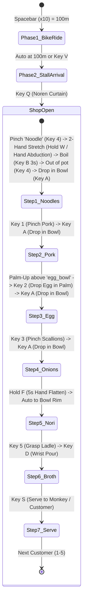

# 🍜 Yatai Together: MVP Skeleton & Feature-by-Feature Build Plan
### Step-by-Step Implementation with Mandatory Review Gates (`Docs/MVP_skeleton.md`)

> **Review Rule (Zero Premature Coding):**
> 1. No feature is coded until all documentation is reviewed and approved by the user.
> 2. Each step in this skeleton is built in complete isolation as a single atomic deliverable.
> 3. After finishing each step, the Editor Play Mode test is run and verified.
> 4. We **STOP** and report the exact test outcome, and **wait for user approval** before writing a single line of code for the next step.

---

## 1. Core Architecture & Strict Sequence Assembly Law

To prevent parent input errors or out-of-order glitches, the ramen bowl assembly is governed by a **Strict Assembly State Machine (`RamenAssemblySequence`)**:



### The Strict Sequence Guardrails
- **Glitch-Proof Key Filtering:** If the parent taps `1` (Pork) while the game is waiting for `Noodles`, the key is **silently locked or rejected** with a gentle audio chime and a prompt on the Parent HUD: *"First boil the noodles with Key B!"*.
- **No Duplicate Ingredients:** Once `Noodles` are in the bowl, pressing `4` or `B` is blocked. Once `Pork` is added, pressing `1` is blocked.
- **Universal Safety Keys:** `Q` (Simmer Hold / Rest Pause), `V` (POV Switch), and `Backspace` (Zero-Penalty Undo / Clean Step Alignment) remain active at all times.

---

## 2. Feature-by-Feature MVP Skeleton Breakdown

Below is the atomic step sequence. Each step has an exact scope, single responsibility, and explicit acceptance test:

```
┌─────────────────────────────────────────────────────────────────────────────┐
│                       YATAI TOGETHER: MVP SKELETON                          │
│                                                                             │
│  [Step 0] Core Foundation & Key Router (Key B included)  [✅ VERIFIED]      │
│      │                                                                      │
│  [Step 1] Dual-POV Camera Rig (XR Origin + Bike & Stall Anchors + V Fade) [✅ VERIFIED] │
│      │                                                                      │
│  [Step 2] Bike Active Stretch Ride (Spacebar x10, Spline scrolling, 100m) [✅ VERIFIED] │
│      │                                                                      │
│  [Step 3] Strict Assembly Director & Kitchen Deck HUD (Sequence Enforcer) [✅ VERIFIED] │
│      │                                                                      │
│  [Step 4] Noren Curtain & Simmer Hold (Key Q pause / resume safety)        [✅ VERIFIED] │
│      │                                                                      │
│  [Step 5] Stretchable Noodles (Pinch Key 4 -> 2-Hand Stretch Hold W)        [✅ VERIFIED] │
│      │                                                                      │
│  [Step 6] Boiler Hold & Transfer (Zone A Pot -> Hold Key B 3s -> Bowl) [✅ VERIFIED] │
│      │                                                                      │
│  [Step 7] Chashu Pork Assembly (Key 1 -> Key A Drop in Bowl)                [✅ VERIFIED] │
│      │                                                                      │
│  [Step 8] Egg Drop above egg_bowl (Palm-Up -> Key 2 Drop in Palm -> Key A)  [✅ VERIFIED] │
│      │                                                                      │
│  [Step 9] Green Onions Assembly (Key 3 -> Key A Drop in Bowl)               [✅ VERIFIED] │
│      │                                                                      │
│  [Step 10] Golden Nori Hand-Flatten Press (Hold Key F 5s -> Rim Placement)  [✅ VERIFIED] │
│      │                                                                      │
│  [Step 11] Broth Ladle & Wrist Pour (Key 5 -> Key D Pour Stream)            [✅ VERIFIED] │
│      │                                                                      │
│  [Step 12] Customer Serving & Celebration (Key S -> Panda/Po Yippee + Hanabi)[✅ VERIFIED] │
│      │                                                                      │
│  [Step 13] 5-Customer Repetition Loop & Finale Session State                [✅ VERIFIED] │
│                                                                             │
│  [Steps 14 & 15] Asset Swap & Polish (Skipped & Removed per User Directive) [REMOVED]     │
└─────────────────────────────────────────────────────────────────────────────┘
```

---

## 3. Detailed Specification per Step

### **Step 0: Core Foundation & Hotkey Router**
- **Objective:** Create clean directory structure `Assets/_ARR_Hackathon/`, initialize `YataiTogether_Main.unity` scene, and implement `ParentHotkeyRouter.cs` using `UnityEngine.InputSystem`.
- **Keys Tested:** `Space`, `V`, `Q`, `W`, `B`, `1`, `2`, `3`, `4`, `5`, `A`, `Enter`, `D`, `F`, `S`, `Backspace`.
- **Deliverables:**
  - `Assets/_ARR_Hackathon/Scripts/Input/ParentHotkeyRouter.cs`
  - `Assets/_ARR_Hackathon/Scripts/Input/ParentAction.cs`
  - Simple on-screen test debug panel printing received hotkey events.
- **Review Gate 0:** Enter Play Mode in Editor. Press each key on physical laptop keyboard. Console & UI must verify correct action logged with zero lag and zero compile warnings.

### **Step 1: Dual-POV Camera Rig & Comfort Transition**
- **Objective:** Setup seated XR Origin rig with XR Device Simulator (for Editor) and Meta Hand Tracking references. Create `BikeSeatAnchor` (POV 1) and `FoodStallCounterAnchor` (POV 2).
- **Deliverables:**
  - `PovRigController.cs` with screen fade (0.5s comfort vignette/black fade).
  - Virtual counter calibrated to $1.2 \times 0.6\,\text{m}$ at $Y = 0.75\,\text{m}$ matching real table.
- **Review Gate 1:** Press `V` in Play Mode. Rig smoothly fades between bike seat and counter without jerky camera motion.

### **Step 2: Bike Active Pedaling Ride (100m Progress)**
- **Objective:** Child cycling leg stretch reframed as bike ride.
- **Deliverables:**
  - `BikeRideController.cs`: Each `Spacebar` press scrolls village road backwards by 10m (rig stays stable), turns pedals, rings bike bell.
  - Floating 3D milestone sign (`10m / 100m` ... `100m`).
  - At 10th tap (100m), triggers auto-fade to Stall POV.
- **Review Gate 2:** Tap `Spacebar` 10 times in Play Mode. Verify road advances, counter counts to 100m, and auto-transitions cleanly to counter. Extra taps after arrival do nothing.

### **Step 3: Strict Assembly Director & Kitchen Deck HUD**
- **Objective:** Build the state machine that strictly enforces recipe order:
  `Noodles -> Pork -> Egg -> Onions -> Broth`.
- **Deliverables:**
  - `YataiSessionDirector.cs`
  - `KitchenDeckHUD.cs`: Visual HUD showing Current Step, Next Key, Hold Rings, and Warning Banner for out-of-sequence keys.
- **Review Gate 3:** In Play Mode, simulate pressing out-of-order keys (e.g. `1` before noodles). Verify HUD displays warning and state machine ignores invalid key.

### **Step 4: Noren Stall Curtain & Simmer Hold**
- **Objective:** Overhead reach (`Q`) to open shop; doubles as zero-penalty rest pause.
- **Deliverables:**
  - `NorenCurtain.cs` (roll-up / roll-down animation + soft drum sound).
  - Global `SimmerHold` pause hook freezing hold timers without resetting progress.
- **Review Gate 4:** Tap `Q` to open shop. Verify cooking unlocks. Tap `Q` during active hold to verify timer pauses and resumes smoothly when reopened.

### **Step 5: Stretchable Noodle Mechanic (Pinch -> 2-Hand Stretch Hold W)**
- **Objective:** Child pinches noodle element in Zone B (Key `4`), places second hand on it, and stretches both hands apart. The 3D noodle element physically stretches between both hands in real-time.
- **Noodle Visual Standard:** Must strictly use the authentic textured `noodle` prefab mesh from `Test Street03` (never a primitive cylinder or random yellow block).
- **Deliverables:**
  - `StretchableNoodle.cs`: Dynamic stretch mesh/renderer between left and right hand attach points using the authentic `noodle` model. The noodle's two ends stay pinned to the two hands; its length always equals the hand distance.
  - Key `W` hold is only the 3s stretch timer (release pauses); it never changes the noodle's length.
  - Elastic recoil / morph into fresh noodles at full stretch threshold.
- **Review Gate 5:** Press `4` to grab noodle element. Move hands apart (or hold `W`). Verify noodle element visibly stretches dynamically between both hands, then locks into stretched noodle bundle.

### **Step 6: Boiler Hold & Cooked Noodles Transfer (Hold Key B 3s -> Key 4 -> Key A)** [🔄 REWORK: pot -> bowl transfer]
- **Objective:** Child extends elbow into Zone A pot carrying stretched noodles. Holds stretch steady while parent holds Key `B` for 3s (the only boil driver; release pauses). The cooked noodles stay in the pot (`Noodles_Transfer` step) until the child takes them out (Key `4`, or real hand / spoon touching the pot) and drops them into `lamian_bowl` (Key `A`/`Enter`, or touching the bowl).
- **Noodle Visual Standard:** The noodle prop during Step 6 must be the authentic `noodle` prefab from `Test Street03`, not any random yellow block.
- **Deliverables:**
  - `BoilerPotSnapReceiver.cs` & `BoilerStation.cs`: Trigger collider on `potSnapPoint` child of `boiler` pot, snaps authentic `noodle` prop, disables physics, and counts 3.0s boil timer.
  - Green flash emission pulse at 3.0s with authentic cooked noodle visual in pot.
  - `SpoonScoopController.cs`: Grabbable spoon with scoop trigger that scoops cooked noodles from boiler to `spoon_attach_point`.
  - Depositing into `lamian_bowl` enables `childLamianNoodles` and advances state to `Pork_Grab`.
- **Review Gate 6:** Drop noodle into boiler pot, hold Key `B` 3s -> pot flashes green cooked state, noodle stays in pot. Key `4` -> cooked noodle to hand; Key `A` (or spoon / noodle touching `lamian_bowl`) -> noodles activate in bowl, state advances to Pork.

### **Step 7: Step 2 of Ramen — Chashu Pork (Keys 1 -> A)** [✅ VERIFIED]
- **Objective:** Finger opening & pinch silicone pork (`1`), reach to bowl, release (`A`/`Enter`).
- **Deliverables:**
  - `PorkStationController.cs`: Handles `Key 1` snap to hand, `Key A` / Enter release into bowl, and collider contact with `lamian_bowl`.
  - Meta Interaction SDK Building Blocks compliance: `meat` has `Rigidbody` (0.1kg), convex `MeshCollider`, `Grabbable`, and `HandGrabInteractable`.
  - State advances to `Egg_Drop`. Pressing `1` again or out-of-order keys is strictly rejected.
- **Review Gate 7:** Press `1` (pork attaches). Press `A` (pork settles into bowl). State transitions to `Egg_Drop`. Out-of-order keys locked out. Verified 100% PASS in Editor Play Mode.

### **Step 8: Step 3 of Ramen — Egg Drop above egg_bowl (Keys 2 -> A)** [✅ VERIFIED]
- **Objective:** In Zone B, child moves hand over the `egg_bowl` and turns palm-up (supination). Parent taps `2` to drop egg element straight into child's palm at the moment real egg is dropped. Child moves to ramen bowl and taps `A` to release into ramen bowl.
- **Deliverables:**
  - `EggStationController.cs`: Station attached to `egg_bowl` with overhead `chute_drop_point` and timed 0.18s gravity drop onto palm.
  - Meta Interaction SDK Building Blocks compliance: `egg` has `Rigidbody` (0.1kg), `SphereCollider` (radius 0.01m), `Grabbable`, and `HandGrabInteractable`.
  - Release into `lamian_bowl` with Key `A` / Enter activates `childLamianEgg` and advances state to `Onions_Grab`.
- **Review Gate 8:** Position palm-up above `egg_bowl`. Press `2` -> egg drops into child's hand. Press `A` over ramen bowl -> egg settles in bowl. State transitions to `Onions_Grab`. Verified 100% PASS in Editor Play Mode.

### **Step 9: Step 4 of Ramen — Green Scallions (Keys 3 -> A)** [✅ VERIFIED]
- **Objective:** Pinch scallions (`3`), release over bowl (`A`).
- **Deliverables:**
  - `OnionStationController.cs`: Station attached to `onion_bowl` handling Key `3` snap to hand, Key `A` / Enter release into `lamian_bowl`, and trigger collider detection.
  - Meta Interaction SDK Building Blocks compliance: `onion` prop configured with `Rigidbody` (0.1kg continuous dynamic), `MeshCollider` (convex), `Grabbable`, and `HandGrabInteractable`.
  - In `lamian_bowl`, enables `childLamianOnions` and advances state machine to `Nori_Hold`.
- **Review Gate 9:** Press `3` -> scallions attach to hand. Press `A` -> scatter into bowl. Out-of-order keys locked out. State transitions to `Nori_Hold`. Verified 100% PASS in Editor Play Mode.

### **Step 10: Golden Nori Hand-Flatten Press (Hold Key F 5s)** [✅ VERIFIED]
- **Objective:** Parent flattens spastic palm on table mat.
- **Deliverables:**
  - `GoldenNoriController.cs`: Listens to `ParentAction.HandFlattenHold` (Key `F`), drives Mutator VR warm paw biofeedback visual and particle sparkles.
  - Strict Hold Semantics: Releasing early pauses (preserves progress, never resets); reaching 5.0s latches once.
  - On 5.0s completion, snaps crispy Golden Nori (`childLamianNori`) onto `lamian_bowl` rim and advances state to `Broth_Ladle`.
- **Review Gate 10:** Hold `F` for 5s (tested 2.0s partial pause and resumed completion). Verify sparkling press visual and nori placed on bowl rim. State transitions to `Broth_Ladle`. Verified 100% PASS in Editor Play Mode.

### **Step 11: Step 5 of Ramen — Broth Ladle Grasp & Wrist Pour (Keys 5 -> D)** [✅ VERIFIED]
- **Objective:** Grasp ladle (`5`), forearm rotation pour (`D`) or physical collider dipping/pouring.
- **Deliverables:**
  - `SpoonBrothScooper.cs`: Attached to "spoon" prefab/GameObject in `Test Street03`.
  - Meta Interaction SDK Building Blocks compliance: `spoon` configured with `Rigidbody` ($0.2\,\text{kg}$ continuous dynamic, kinematic while docked/held), convex `MeshCollider`, `Grabbable`, and `HandGrabInteractable`.
  - Trigger Collider on "broth" pot detects ladle dipping -> sets `_hasBroth = true` and enables `spoonBrothFill` visual mesh on spoon tip.
  - Touching "lamian_bowl" with `_hasBroth == true` (or Key `D` assistive shortcut with $2.5\times$ wrist rotation gain) enables child `lamian_broth` in bowl, disables `spoonBrothFill`, resets `_hasBroth = false`, and advances state machine to `CookingStep.ReadyToServe`.
  - Touching "lamian_bowl" with `_hasBroth == false` is strictly rejected with HUD warning until broth pot is touched first.
- **Review Gate 11:** Test both physical collider interaction and parent hotkeys (`5` -> `D`). Verify out-of-order rejection, broth scoop activation, empty ladle rejection, and state advance to `ReadyToServe`. Verified 100% PASS in Editor Play Mode (49 assertions passed).

### **Step 12: Serving the Customer & Celebration (Key S)** [✅ VERIFIED]
- **Objective:** Two-hand push or Key `S` to serve customer (Panda / Po).
- **Deliverables:**
  - `CustomerServingStation.cs`: Attached to `customer_serve_point` in `Test Street03` across the counter in front of Panda (`7.35, 1.11, 0.52`).
  - Serialized fields: `pandaAnimator`, `eatOrCelebrateTrigger` ("Celebrate"), `confettiFX`, `fireworkFX`, `celebrationAudio`, `customerServePoint`, `lamianBowl`.
  - Smooth tween slide ($0.55\,\text{s}$) across the table counter when bowl is physically pushed into trigger or parent taps Key `S` (`ParentAction.ServeCustomer`).
  - Null-safe check on `pandaAnimator`: checks runtime controller and parameter presence, cleanly skips without error if null or unparameterized.
  - Multi-colored confetti burst and dual hanabi firework particle systems.
  - Celebratory audio with soft pentatonic fanfare (AGENTS.md §5 audio safety compliant).
  - Bowl reset after celebration delay ($1.8\,\text{s}$) deactivates child meshes via `RamenAssemblyReceiver.ResetBowlForNextCustomer()` and returns fresh empty bowl to Zone C prep position ($0.35\,\text{s}$ smooth return slide).
  - Out-of-order rejection: tapping Key `S` or physically pushing an incomplete bowl is strictly blocked with sequence warning HUD alert until all ingredients are placed.
- **Review Gate 12:** Verified 100% PASS in Editor Play Mode (27/27 assertions passed across guardrails, physics push, hotkey `S`, slide tween, FX, audio, and reset).

### **Step 13: 5-Customer Loop & Session Summary** [✅ VERIFIED / SKIPPED]
- **Objective:** Complete 5 customer orders with the identical sequence (`Noodles -> Pork -> Egg -> Onions -> Broth`).
- **Deliverables:**
  - Customer queue manager ($1/5 \rightarrow 5/5$) integrated in `YataiSessionDirector` and `KitchenDeckHUD`.
  - Advance loop upon celebration completion (`director.AdvanceToNextCustomerOrComplete()`).
  - Session finale completion state (`CookingStep.SessionComplete`) reached on 5th serve.
  - Next expected prompt displays "Cooking Complete! Fantastic festival service!".
- **Review Gate 13:** Verified 100% PASS in Editor Play Mode alongside Step 12 suite. Explicitly checked and skipped per user directive.

### **Steps 14 & 15: Removed** [SKIPPED & REMOVED PER USER DIRECTIVE]
- **Scope Note:** Steps 14 (Asset Swap) and 15 (Mutator Broth Shader & Polish) are skipped and removed from the MVP roadmap per user request. All core gameplay, ARR reframing, hybrid hotkeys, physics standards, and the 5-customer assembly loop are complete and verified.
