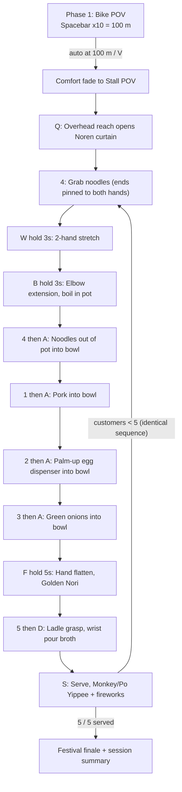

# 🍜 Yatai Together: The Festival Ramen Cart
## Game Concept Document — v2 (Hybrid Hotkey Actuation)

> **Status:** Draft for review — no gameplay code is written until this doc, `implementation_roadmap.md`, and `AGENTS.md` are approved.
> **Changes in v2:** see [§10 Changelog](#10-changelog-v1--v2).

---

### 1. Executive Summary & Cerebral Palsy Clinical Alignment

*Yatai Together* is an **Asymmetric Reframed Reality (ARR)** VR rehabilitation game for children with **Unilateral Spastic Cerebral Palsy (Hemiplegia, GMFCS Level I–II, MACS Level II)** and their parents.

#### Why This Is Not "Just Any Cooking Game"
In spastic hemiplegia, hypertonic muscles pull the affected arm into a **spastic flexor synergy**: shoulder adducts, elbow bends, forearm locks palm-down (pronation), wrist curls, fingers clench, thumb tucks into the palm. Because the limb is hard to use, the child develops **Developmental Disregard** (ignoring the limb), and fast or forced stretching by an untrained parent triggers **involuntary muscle guarding** and pain.

*Yatai Together* replaces clinical stretching with a shared cooking story set at a Japanese night festival (*Hanabi Matsuri*):
- **Child (Quest 3 headset)** = **Head Ramen Chef**. Rides the ramen bike-cart to the festival, then cooks and serves 5 bowls.
- **Parent (laptop, no headset)** = **Sous-Chef Partner**. Physically guides each stretch, hands over the real props, and presses one-handed hotkeys that make the virtual kitchen react at the exact moment the child feels the real thing.
- **Po the Giant Panda** (plus 4 other animal villagers) = the customers. Po's warm paw is how the parent's flattening hand appears in VR.

> [!NOTE]
> "Po" is also the name of DreamWorks' *Kung Fu Panda* character. That's fine for a hackathon demo, but consider an original name for anything published.

---

### 2. Hybrid Hotkey Actuation — The Core Interaction Model

#### The Problem
When a parent supports a child's spastic hand, or places a silicone/felt prop into their palm, the parent's hands block the Quest 3 cameras. Optical hand tracking then jitters, flickers, or locks onto the **parent's** hand. Quest 3 also can't track small, soft props (silicone pork, yarn noodles) at all.

#### The Rule: *Quest tracks WHERE, the parent decides WHEN*

| Channel | Owner | What it does | Failure behaviour |
| --- | --- | --- | --- |
| **Continuous 3D tracking** | Quest 3 (child's affected wrist/hand) | Moves the child's virtual hand, so held ingredients follow the real arm through space. Also streams wrist speed and steadiness to the Parent HUD. | If tracking drops, the virtual hand holds its last good pose and fades in again later. **It never blocks progress.** |
| **Discrete events** | Parent's laptop hotkeys | Grab/lock an ingredient, release it, start or charge a stretch hold, trigger physical-virtual sync moments (egg drop), serve, switch POV. | Deterministic: 100% reliable, no lag. |

> [!TIP]
> **Primary Tracking:** Quest 3 optical Hand Tracking (via Meta XR Core SDK & Unity XR Hands). Quest tracks the continuous 3D hand/wrist pose in space, while the parent's discrete keyboard hotkeys trigger attachment and release.

```
               HYBRID PROP-TO-VR SYNCHRONIZATION PIPELINE
 ┌─────────────────────────────┐       ┌─────────────────────────────┐
 │   CHILD (Real World)        │       │  PARENT (Sous-Chef Station) │
 │ Pinches real silicone pork, │──────►│ Sees grasp in real life     │
 │ turns palm up for egg, etc. │       │ Taps 1 / 2 / 3 / 4 / 5 ...  │
 └──────────────┬──────────────┘       └──────────────┬──────────────┘
                │ Quest 3: continuous hand tracking   │ Laptop: discrete hotkey event
                ▼                                     ▼
 ┌───────────────────────────────────────────────────────────────────┐
 │                       UNITY 6 (Yatai Together)                    │
 │ • Snaps 3D ingredient onto the child's tracked virtual hand       │
 │ • Or drops the Magic Egg into the upturned virtual palm           │
 │ • Result: haptic + visual congruency with ZERO tracking lag       │
 └───────────────────────────────────────────────────────────────────┘
```

---

### 3. Ergonomic Keyboard Layout (One-Handed Parent Operation)

The parent uses one hand to guide/stretch the child's affected limb, so **every hotkey sits on the left side of the keyboard** (plus `Spacebar`, `Enter`, `Backspace`). The parent can press everything with the free hand without looking down.

```
┌─────────────────────────────────────────────────────────────────────────────┐
│                   PARENT ONE-HANDED KEYBOARD CLUSTER                        │
│                                                                             │
│   [ 1 ]     [ 2 ]     [ 3 ]     [ 4 ]     [ 5 ]              [ Backspace ]  │
│   Pork     Egg Drop   Onions   Noodles    Ladle              Reset Step     │
│  (Pinch)  (Palm-Up)  (Pinch)   (Pinch)   (Grasp)                            │
│                                                                             │
│      [ Q ]     [ W ]     [ E ]     [ B ]                                    │
│     Curtain   2-Hand    Elbow      Boil Timer                               │
│     Reach    Band Pull  Stretch   (Hold 3s)                                 │
│                                                                             │
│         [ A ]     [ S ]     [ D ]     [ F ]                  [   ENTER   ]  │
│         Drop     Serve    Pour Broth  Flatten                Drop / Release │
│        in Bowl  Customer  (Wrist)    Hand (Hold)             Held Item      │
│                                                                             │
│                        [       SPACEBAR       ]              [     V     ]  │
│                         Bike Pedal (+10 Meters)               Switch POV    │
└─────────────────────────────────────────────────────────────────────────────┘
```

---

### 4. Master Pre-Assigned Hotkey Table

| Hotkey | Trigger | Target CP Movement | Real-World Physical Action (Child + Parent) | VR Game Action (Unity) |
| --- | --- | --- | --- | --- |
| **`Spacebar`** | Tap (×10) | **Lower-limb active cycling stretch** | Child does a full cycling stretch with their legs. Parent assists and taps on each good stretch. | Bike + cart advance **10 m** per tap along the village road. Pedals turn one revolution, the bell chimes, and the banner updates (`10m / 100m`). At **100 m**, Monkey / Po waves and the view fades to the Food Stall POV. |
| **`V`** | Tap (failsafe) | POV transition override | Child finishes pedalling and turns to face the real tabletop stall. | Toggles the camera rig between **POV 1 `BikeSeatAnchor`** and **POV 2 `FoodStallCounterAnchor`** behind a comfort fade. |
| **`Q`** | Tap (toggle) | **Overhead reach** (shoulder flexion) | Child reaches both hands, or the parent-guided affected hand, high overhead. | Raises the *Noren* stall curtain to open the shop (soft drum roll). Pressing again lowers it for a zero-penalty **"Simmer Hold"** rest break that freezes all progress. |
| **`W`** | Hold 3 s | **Two-hand band pull, wrists apart** (bimanual abduction) | Child pulls a resistance band apart with both hands. | A glowing golden dough log stretches between both virtual hands. After 3 s of accumulated hold, it turns into fresh noodles in Zone B. |
| **`4`** | Tap | **Pinch & grasp** (noodles) | Child pinches the real cotton/yarn noodles in Zone B. | 3D `UncookedNoodles` snap onto the child's virtual hand and follow the real arm. |
| **`B`** | Hold 3 s | **Straighten elbow, stretch & hold** (elbow extension) | Child pushes the arm forward over the Zone A boiler pot while the parent supports the elbow and holds the stretch steady. | Noodles drop into the boiler pot and a **3 s circular clock** appears in front of it. At 3.0 s, the clock flashes bright green; the cooked noodles stay in the pot until the child takes them out (`4`) and drops them into the Zone C bowl (`A`/`Enter`). |
| **`1`** | Tap | **Finger opening & pinch** (pork) | Child opens curled fingers and pinches the squishy silicone/felt Chashu pork in Zone B. | 3D `ChashuPork` slice locks onto the child's virtual pinch point. |
| **`2`** | Tap | **Forearm palm-up** (supination, egg dispenser) | Child turns the forearm palm-up under the chute. The parent taps `2` **at the same moment they drop the real silicone egg half into the open palm**. | The **Magic Bamboo Ajitama Egg Dispenser** releases a golden marinated egg that lands in the virtual palm at the same instant the real egg lands (see §6.3 timing). |
| **`3`** | Tap | **Finger opening & pinch** (onions) | Child pinches the shredded paper / green foam scallions in Zone B. | A bright cluster of 3D `GreenOnions` locks onto the child's virtual hand. |
| **`F`** | Hold 5 s | **Parent flattens hand & holds** (wrist & finger flexor release) | Child rests the affected hand flat on Zone D. The parent gently flattens the palm/fingers against the table and holds. | **Monkey / Po's warm paw** covers the child's virtual hand and presses a glowing **Golden Nori sheet** flat on the counter. At 5 s, a mini sparkler fires and the crispy Nori floats into the bowl. |
| **`A`** / **`Enter`** | Tap | **Reach & let go** (active finger release) | Child reaches over the real plastic bowl in Zone C and opens the fingers to release the prop. | Releases whatever ingredient is held (pork / egg / onions / noodles). Bouncy low-mass physics drops it **into** the bowl (magnetised, so it never misses). |
| **`5`** | Tap | **Gross grasp** (broth ladle) | Child grasps the real lightweight plastic ladle in Zone A. | 3D `SoupLadle` filled with steaming golden broth locks into the child's virtual hand. |
| **`D`** | Tap | **Forearm rotation / wrist pour** | Child moves the ladle over Zone C and turns the wrist to pour. | Ladle tilts about 90° (2.5× visual-motor gain on the tracked wrist roll) and pours a broth particle stream until the bowl is full. |
| **`S`** | Tap | **Two-hand reach forward** (serve) | Child pushes/lifts the real bowl toward the front edge of the mat. | The bowl slides to **Monkey / Po** (customer). Customer does a **"Yippee!"** arms-up celebration, **fireworks** rise behind them, the counter increments (`1/5 → 5/5`), and a fresh empty bowl appears in Zone C. |
| **`Backspace`** | Tap (failsafe) | Zero-penalty undo / reset | Used when a prop drops early or needs repositioning. | Clears any stuck held item and cleanly snaps the current step's ingredient into the bowl, **without** resetting overall recipe progress. |

**Hold-key semantics (W / B / F):** releasing the key early **pauses** the timer; it never resets or fails. Progress continues when the key is pressed again. Each hold completes once (latched) and doesn't repeat while the key is still held.

---

### 4.1 Strict Assembly Sequence Law

The ramen bowl preparation must follow a **strict invariant sequence**:
$$\text{Noodles} \longrightarrow \text{Chashu Pork} \longrightarrow \text{Ajitama Egg} \longrightarrow \text{Green Onions} \longrightarrow \text{Broth (Ladle)}$$

1. **State-Locked Key Processing:** If an ingredient key is pressed before its turn (e.g. parent presses `1` for Pork before Noodles have been boiled and transferred), the input is rejected. The HUD displays a clear warning: *"Sequence locked: Finish Noodles first!"*.
2. **No Re-triggering Completed Ingredients:** Once an ingredient is added to the bowl, its key cannot be pressed again for that bowl. For instance, pressing `4` or `B` after noodles are already in the bowl is ignored.
3. **Identical Recipe for All 5 Customers:** Every customer order follows this exact sequence, reinforcing motor memory and habit formation.

---

### 5. Session Flow at a Glance



`Q` (rest break) and `Backspace` (reset step) are available at any point after arrival. `V` is available at any time.

---

### 6. Step-by-Step Choreography

#### Phase 1 — Leg Active Stretching & Dual-POV Transition (`Spacebar`, `V`)
1. **Start (POV 1 — Bike Seat):** On Play, the camera rig sits at `BikeSeatAnchor`. The child looks down at the bike handlebars attached to the wooden ramen cart on a lantern-lit village road.
2. **Physical loop:** The child sits on a chair and performs active cycling leg stretches. No leg trackers to fall off: the parent is the **Quality & Pacing Coach** and taps `Spacebar` after each smooth, full-range cycle.
3. **Feedback per tap:** pedals turn one revolution, the bell chimes softly, the cart moves 10 m closer to the festival (the village scrolls past; see AGENTS.md §1), and the 3D banner updates (`10m / 100m` … `100m / 100m`).
4. **Arrival:** On the 10th tap, Po waves from the stall entrance and the view **fades** (~0.5 s) to `FoodStallCounterAnchor`. The child is now in front of the virtual counter, aligned 1:1 with the real tabletop mat (Zones A–D). `V` toggles POV manually at any time.

#### Phase 2 — Opening the Stall & Making Noodles (`Q`, `4`, `W`, `B`)
1. **Overhead reach → open curtain (`Q`):** the child raises the arms overhead. At peak extension, the parent taps `Q` and the *Noren* rolls up with a soft festival drum. If the child gets tired, reaching up again + `Q` lowers the curtain for a rest break with zero penalty.
2. **Pinch noodle element & 2-Hand Dynamic Stretch (`4` → hold `W` / hand abduction):**
   * The child pinches the physical noodle dough/cluster in Zone B. Parent taps **`4`**, attaching the 3D noodle element to the child's virtual hand. *(Note: Must strictly use the authentic textured `noodle` prefab from `Test Street03`, never a primitive cylinder or random yellow block).*
   * The child brings their second hand to the noodle element and grasps it with **both hands**. In VR, the noodle's two ends are pinned to the two virtual hands.
   * The child pulls their wrists outward apart (bimanual abduction).
   * In VR, the **authentic 3D noodle mesh dynamically stretches** between both hands in real-time: its length always equals the distance between the hands.
   * Holding **`W`** for 3 s (accumulated; releasing pauses) completes the stretch. `W` is only the hold timer; it never changes the noodle's length.
3. **Elbow extension → boil noodles (`B` hold 3s):**
   * The child straightens their elbow forward over the Zone A boiler pot while the parent supports the elbow. The noodle leaves the hands and drops into the pot when `B` starts (or when it touches the pot).
   * The parent holds **`B`** (Boil Timer, the only boil driver; releasing pauses): a 3D circular clock appears in front of the pot (`3… 2… 1…`) and flashes bright green at 3.0 s. The cooked noodles stay in the pot.
4. **Noodles out of the pot → bowl (`4` → `A`/`Enter`):**
   * The child reaches into the pot (or scoops with the spoon). Parent taps **`4`** and the cooked noodles snap to the child's hand.
   * The child reaches over the Zone C bowl and opens the fingers. Parent taps **`A`/`Enter`** (or the noodles touch the bowl) and the noodles drop into the ramen bowl.
5. **Strict Sequence Enforcement:** The bowl now holds noodles. The state machine locks out noodles (`4`, `B`) and will ONLY accept Chashu Pork (`1`), preventing any out-of-order glitches.

#### Phase 3 — Toppings, Palm-Up Egg above egg_bowl & Hand Flattening (`1`, `2`, `3`, `F`, `A`/`Enter`)
The Quest tracks the hand's 3D position over the table. The parent presses the ingredient key at the moment the child touches or catches the real prop, and presses `A`/`Enter` at the moment the child opens their fingers over the real Zone C bowl.

1. **Chashu pork (`1` → `A`):** pinch silicone pork → `1` (pork snaps to hand) → reach over the bowl, open fingers → `A` (pork bounces into the bowl). State advances to Egg.
2. **Ajitama Egg Drop above `egg_bowl` (`2` → `A`):**
   * In Zone B sits the dedicated **`egg_bowl`** prop.
   * **Physical Action:** The child turns their forearm **palm-up (supination)** directly above the `egg_bowl`.
   * **Parent Key Sync:** The parent clicks **`2`** on the laptop at the exact split-second they drop the physical silicone egg into the child's palm.
   * **VR Action:** In VR, the egg element drops from the chute directly above the `egg_bowl` cleanly into the child's upturned virtual hand!
   * The child moves their hand over the Zone C ramen bowl and relaxes fingers $\rightarrow$ parent taps **`A`** to drop the egg into the bowl. State advances to Green Onions.
3. **Green onions (`3` → `A`):** pinch paper/foam scallions → `3` → release over the bowl → `A` (onions scatter in). State advances to Nori.
4. **Golden Nori press (hold `F`):** the child places the palm down on Zone D. The parent gently flattens the fingers and palm and holds `F` with the other hand. Monkey / Po's paw covers the child's virtual hand and presses the Nori flat. Golden sparkles charge for 5 s, then the Nori floats onto the side of the bowl. State advances to Broth.

##### 6.3 Egg-drop timing (why the chute must be short)
A real egg dropped from about 15 cm hits the palm in roughly **0.175 s** (t = √(2h/g)). If the VR egg instead slid down a long chute for 1 s, the child would feel the egg before seeing it. So the chute **exit** sits about 15 cm above the virtual palm. On `2`, the egg is released from the exit and falls under the same gravity, so both eggs land within about 1–2 frames of each other. The chute "slide" is decorative and plays *before* the drop, while the parent lines up.

#### Phase 4 — Broth, Wrist Pour & Customer Fireworks (`5`, `D`, `S`)
1. **Ladle grasp + wrist pour (`5` → `D`):** the child grasps the real plastic ladle in Zone A → `5` (broth-filled ladle attaches). The child moves it over Zone C and turns the wrist → `D` (the ladle tilts with 2.5× rotational gain and broth pours in).
2. **Serve (`S`):** the child pushes the real bowl forward → `S`. Po receives it, raises both arms in a **"Yippee!"**, and fireworks rise behind him. A fresh empty bowl appears in Zone C and the next customer steps up, until **5 customers** are served.

---

### 7. Making the Experience Asymmetric & Reframed for the Parent Too

**Clinical safety rule:** the parent **must not** wear a headset. They need clear vision to support the elbow, flatten the curled hand safely, and drop props into the palm.

**Reframing problem:** a parent staring at a debug screen still feels like an anxious therapist forcing their child through rehab.

**Solution: the "Sous-Chef Co-Op Kitchen Deck"**
1. **Sous-Chef Order & Rhythm Deck (laptop screen):** styled as **Po's Kitchen Deck**, not a medical chart. It shows the current step and the next expected key, the one-handed key cluster with live key highlights, the hold-progress rings (W/E/F), the bike distance, the customer count, and a **Speed Pacer / Resistance ring** driven by the tracked wrist. During `F`, a sizzling **Golden Nori Press Meter** plays with Po's voice: *"Sous-Chef! Help the Head Chef press that Nori nice and flat! 5… 4… 3… 2… 1… Crispy perfection!"*
2. **Parent as the kitchen machine:** in the egg step, an aiming reticle shows when the child's palm is turned up far enough (tracked palm normal). The parent taps `2` and drops the real egg at the same moment. The parent **is** the physical engine of the virtual kitchen.
3. **Shared festival soundscape:** festival music, bubbling broth, bike bells, and Po's "Yippee!" play through the laptop speakers too, so parent and child share the same night market.

---

### 8. Tabletop Physical Mat Layout (Zones A → B → C → D)

```
                  PHYSICAL TABLETOP LAYOUT MAT (TOP-DOWN, child sits at bottom edge)
┌──────────────────────────────────────┬──────────────────────────────────────┐
│ [ZONE A: Boiler & Broth Station]     │ [ZONE B: Ingredients (2x2 Trays)]    │
│ • Top-Left: Boiler pot (E: elbow     │ • Box 1: Cotton-string noodles  (4)  │
│   extension target)                  │ • Box 2: Silicone Chashu pork   (1)  │
│ • Bot-Left: Broth pot + light ladle  │ • Box 3: Silicone egg halves    (2)  │
│   (5: grasp)                         │   (held by parent)                   │
│                                      │ • Box 4: Paper/foam green onions (3) │
│                                      │ • Bamboo egg chute hangs above (VR)  │
├──────────────────────────────────────┼──────────────────────────────────────┤
│ [ZONE D: Hand-Flatten & Band Zone]   │ [ZONE C: Assembly Bowl]              │
│ • Padded flat-hand icon: parent      │ • Real plastic ramen bowl, anchored  │
│   flattens & holds child's palm (F)  │ • Reach & let go target (A / Enter)  │
│ • Resistance band for 2-hand pull (W)│ • Wrist pour target (D)              │
│                                      │ • Push forward to serve (S)          │
└──────────────────────────────────────┴──────────────────────────────────────┘
                     Under-desk: chair for cycling leg stretches (Spacebar)
                     Overhead: Noren curtain (Q)
```

> [!IMPORTANT]
> **Open (roadmap Q5):** should the zones mirror left/right based on the child's affected side, so reach targets always challenge the affected arm?

---

### 9. Art, Style & Gameplay Rules

- **Low-poly toy aesthetic:** flat-shaded geometric models, saturated cheerful colours, optional black comic outlines for high contrast.
- **Goofy, forgiving physics:** low-mass, bouncy props. Released items are magnetised into the bowl, and accidental drops look silly, not punishing.
- **Zero win/lose anxiety:** no fail timers, no burnt food, no score penalties. Hold timers pause instead of failing. `S` serves whatever is in the bowl.
- **Child agency:** the overhead **Noren** curtain (`Q`) is the child's rest button. Closing it freezes all progress.
- **No startle audio:** drum, bell, "Yippee!" and fireworks use soft attack envelopes (≥ 0.5 s fade-in) and muffled, distant-sounding pops. No sharp bangs.
- **Mutator broth & steam (biofeedback layer):** during holds, the broth and steam shift from rigid/crystalline to soft, blooming, bioluminescent forms as hold progress and wrist steadiness increase.

---

### 10. Changelog (v1 → v2)

| Area | v1 | v2 (this doc) |
| --- | --- | --- |
| Curtain | `C` + overhead trigger box | **`Q`** tap toggle (closed = Simmer Hold pause) |
| Band pull | `N` / hand-distance check | **Hold `W` 3 s** |
| Elbow extension | Zone A trigger + 3 s timer | **Hold `E` 3 s** (clock in front of pot, auto-transfer to bowl) |
| Key `4` | Nori | **Noodles** (Nori now comes only from the `F` press) |
| Release | `Enter` / `0` | **`A` / `Enter`** (`0` removed) |
| Pour | `P` | **`D`** (`P` removed) |
| Reset | — | **`Backspace`** zero-penalty step reset |
| POV | auto at 100 m | auto at 100 m **+ `V` manual toggle** |
| Key layout | scattered | **left-hand one-handed cluster** |
