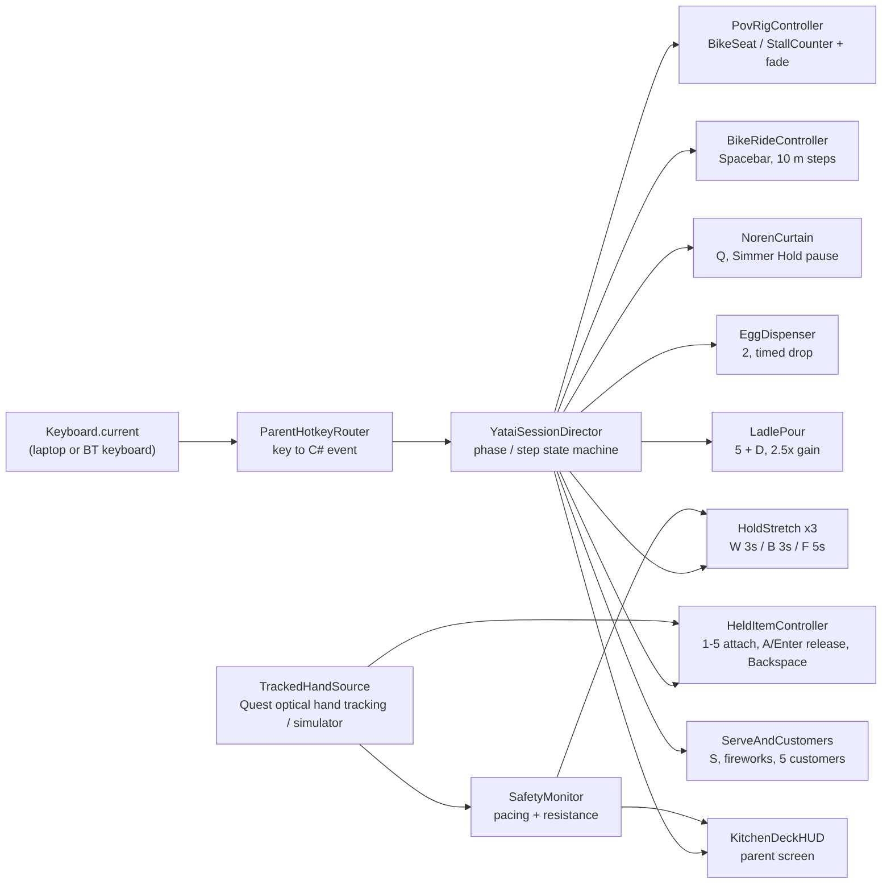

# 🛠️ Yatai Together: Implementation Roadmap — v2 (Hybrid Hotkey Actuation)

> **Status:** Draft for review. **No gameplay code until the user approves this doc, `game_concept_document.md`, and `AGENTS.md`.**
> After approval, we build **one step at a time**. Each step ends with an Editor Play Mode acceptance test and a **review gate**: the user tests it and says "next" before the next step starts.

---

## 1. Verified Project Baseline (as of 2026-11-05)

| Item | Actual value in the project |
| --- | --- |
| Unity Editor | **6000.6.8f1** (Unity 6) |
| Render pipeline | URP 17.6 (`Mobile_RPAsset` / `PC_RPAsset`) |
| Input | **Input System only** (`activeInputHandler: 1`). Legacy `Input.GetKeyDown` **throws** at runtime, so all code uses `UnityEngine.InputSystem`. |
| XR | OpenXR 1.19, XR Interaction Toolkit 3.7, XR Hands 1.10, Meta XR SDK Core / Interaction / Haptics / MRUK 207 |
| Other | Splines 2.9 (bike road path), Timeline 6.6, ProBuilder 6.1 (graybox), TextMeshPro via uGUI 2.6 |
| Scenes | only `Assets/Scenes/SampleScene.unity` |
| Models | only `Assets/Test Street.fbx` (**no food stall or bike model in the project yet**, see Q3) |
| Custom folder | `Assets/_ARR_Hackathon/` **does not exist yet** (created in Step 0) |
| Host OS | **macOS**: Meta Quest Link / Air Link are **not available**, so Editor Play Mode can't stream to the headset (see Q1) |

---

## 2. Target Architecture (small, single-purpose scripts)

The reference `HybridHotkeyActuator.cs` (kept verbatim in [`reference/HybridHotkeyActuator.reference.md`](reference/HybridHotkeyActuator.reference.md)) does everything in one class. We keep its intent, key map, and Inspector-event style, but split it so each step adds **one** component:

- **`ParentHotkeyRouter`**: the only place keys are read. Maps keys to a `ParentAction` enum. Edge-detected taps, and holds report `isHeld`.
- **`YataiSessionDirector` (Strict Sequence Enforcer)**: enforces the strict assembly sequence:
  $$\text{Noodles} \longrightarrow \text{Chashu Pork} \longrightarrow \text{Ajitama Egg} \longrightarrow \text{Green Onions} \longrightarrow \text{Broth (Ladle)}$$
  Prevents accidental parent key presses from causing glitches: keys that have already occurred or are not yet valid are locked out with a visual/audio HUD hint. Failsafes (`V`, `Q`, `Backspace`) are always valid.
- **`TrackedHandSource`**: wraps Quest optical hand tracking (`OVRHand` / XR Hands) with Editor XR Device Simulator fallback.
- **`HoldStretch`**: one reusable component, configured three times (W, B, F). Pauses on key release (never resets), latches on completion, and pauses while `SafetyMonitor` reports "too fast" or Simmer Hold is active.

### Fixes to the reference script (applied as we build each step)

| # | Issue in `HybridHotkeyActuator.cs` | Fix |
| --- | --- | --- |
| 1 | `Spacebar` moves `bikeCartWorldModel` but the camera rig stays put, so the child is left behind (and it conflicts with the AGENTS.md no-camera-motion rule). | Rig + cart stay still. **The village road scrolls backwards** along a Spline (eased ~1 s per 10 m), with an optional comfort vignette. |
| 2 | Hold timers fire **repeatedly** while held (reset to 0 and count again). | Latch: complete once per step, then wait for release. |
| 3 | Boil timer was unassigned or confused between E / R. | **Key `B` is Boil Timer (Hold 3s)**. At 3.0s, noodles transfer to Zone C bowl. |
| 4 | Egg: spawned at chute, then immediately `localPosition = 0`, so it never falls and the visual can't sync with the real drop. | Release from the chute exit ~15 cm above the palm and let gravity drop it (~0.175 s, matching the real egg). |
| 5 | Ladle is never returned. `D` sets a fixed 85° and has no 2.5× gain. | `D` starts the pour: tilt = clamp(2.5 × tracked wrist roll, 0–90°), with a fallback auto-tilt if tracking is lost. Return the ladle to the dock after the pour. |
| 6 | `S` works at any time and clamps at 5 forever. | `S` only valid once the bowl has broth; at 5/5 it plays the finale. |
| 7 | No phase gating: kitchen keys work during the bike ride, ingredients can be added out of order. | `YataiSessionDirector` strictly sequences: Noodles -> Pork -> Egg -> Onions -> Broth. |
| 8 | `SnapCameraToPOV` sets the XR Origin root to the anchor, ignoring the seated head offset. | Anchors mark the **floor point under the seat**. Use `XROrigin.MoveCameraToWorldLocation` / recenter, behind a 0.5 s fade. |
| 9 | Release teleports the item onto the bowl and relies on physics, so items can fall through or pop. | Short arc tween into the bowl, then enable low-mass physics against a bowl collider. |
| 10 | `Backspace` only destroys the held prop. | Also completes the current step's ingredient into the bowl (zero-penalty, per concept doc). |

---

## 3. Step-by-Step Build Plan (one feature per step, review gate after each)

> Every step is built and tested in **Editor Play Mode on the Mac** first (keyboard + XR Device Simulator), per AGENTS.md §6.3.
> **Detailed feature-by-feature breakdown:** see [`Docs/MVP_skeleton.md`](MVP_skeleton.md).

| Step | Feature | Keys | Deliverables | Acceptance test (Editor Play Mode) |
| --- | --- | --- | --- | --- |
| **0** | Foundation | all | `Assets/_ARR_Hackathon/{Scripts,Scenes,Prefabs,Materials,Audio,Models}`, scene `YataiTogether_Main`, `ParentHotkeyRouter` (with `B`), on-screen key log | Every hotkey in the master table logs its `ParentAction` once per tap; hold keys log start/stop. No compile errors, `unity status` = ready. |
| **1** | XR rig + dual POV | `V` | XR Origin (XRI) + XR Device Simulator, `BikeSeatAnchor`, `FoodStallCounterAnchor`, table ($1.2 \times 0.6$ m @ 0.75 m), `PovRigController` with fade | `V` toggles POV with a 0.5 s fade. Counter top lines up with the 0.75 m table cube. |
| **2** | Bike ride | `Space` | Spline road + scrolling village, pedal spin, soft bell, 3D banner `xx m / 100 m`, `BikeRideController` | 10 taps → 100 m, then auto fade to stall POV. Rig never moves during the ride. Taps after arrival are ignored. |
| **3** | Session director + Kitchen Deck HUD | — | `YataiSessionDirector` (strict sequence state machine), `KitchenDeckHUD`: current step, next key, hold rings, distance, customers | HUD shows next valid key. Out-of-order keys show warning and are ignored. |
| **4** | Noren curtain + Simmer Hold | `Q` | `NorenCurtain` roll-up/down, soft drum, global pause flag | `Q` opens the shop and unlocks cooking. `Q` again closes it and freezes every timer, then resumes exactly where it was. |
| **5** | Band pull → noodles | hold `W` | `StretchableNoodle` (authentic `noodle` mesh from `Test Street03`), stretch visual between virtual hands, HUD ring | Holding `W` 3 s (total, release pauses) stretches authentic noodle mesh between hands. Never uses primitive yellow cylinder. |
| **6** | Step 1: Noodles Grab & Boil Hold | `4`, hold `B` | Authentic `noodle` prefab from `Test Street03`, `BoilerPotSnapReceiver`, boiler pot 3s clock, green flash, `Noodles_Transfer` step | `4` grabs authentic raw noodle prop (or confirms stretch into boiler). Holding `B` 3s (only boil driver, release pauses) runs clock and flashes green; noodles stay in pot. `4` takes cooked noodles to hand, `A`/`Enter` drops them into bowl. State advances to Pork. |
| **7** | Step 2: Chashu Pork | `1`, `A`/`Enter` | Pork prefab, arc drop to bowl, physics bounce | `1` attaches pork. `A` drops it into bowl. State advances to Egg. Pressing `1` or `4` again is blocked. |
| **8** | Step 3: Magic Egg Dispenser | `2`, `A` | Bamboo chute, timed ~0.18s gravity drop, palm-up reticle on HUD | `2` drops egg into virtual palm. `A` drops into bowl. State advances to Onions. |
| **9** | Step 4: Green Onions | `3`, `A` | Scallions prefab, scatter drop | `3` attaches onions. `A` drops into bowl. State advances to Nori. |
| **10** | Golden Nori press | hold `F` | Warm paw overlay, Nori sheet, sparkle charge, mini sparkler, HUD press meter + countdown | Holding `F` 5 s charges the Nori, fires the sparkler, and places Nori on bowl rim. State advances to Broth. |
| **11** | Step 5: Ladle + wrist pour | `5`, `D` | Ladle prefab + dock, broth particle stream, bowl fill level, 2.5× roll gain | `5` attaches ladle. `D` pours broth into bowl, ladle docks. State advances to ReadyToServe. |
| **12** | Serve + Customer Celebration | `S` | Customer (Monkey / Po), "Yippee!" arms-up, soft fireworks, counter, fresh bowl | `S` serves, plays celebration, resets to noodles for next customer. |
| **13** | 5-Customer Loop & Physio Summary | — | Customer queue ($1/5 \rightarrow 5/5$), identical recipe loop, session summary | Complete 5 customers with identical sequence. Festival finale triggers at 5/5. |
| **14** | Asset Swap Pass | — | User's Stall, Bike, and Monkey models imported into `Assets/_ARR_Hackathon/Models/` | All user models replace graybox with proper pivots, shaders, and animations. |
| **15** | Polish & Mutator Broth pass | — | Mutator broth/steam shader, spatial audio, 60s vertical slice video recording | Visual/audio polish. Record complete 60s vertical slice. |

---

## 4. Parent Co-Pilot Cheat Sheet (shown on the Kitchen Deck HUD)

| Key | Movement | What happens |
| --- | --- | --- |
| `Space` | Leg cycling stretch | +10 m, auto stall POV at 100 m |
| `V` | — (failsafe) | Toggle Bike ↔ Stall POV |
| `Q` | Overhead reach | Open curtain / close for Simmer Hold rest |
| hold `W` 3 s | Two-hand band pull | Dough → noodles |
| `4` | Pinch noodles | Noodles to hand (ends pinned to both hands) / cooked noodles out of pot |
| hold `B` 3 s | Elbow extension hold | Boil timer, green clock (then `4` → `A` to bowl) |
| `1` | Pinch pork | Pork to hand |
| `2` | Palm-up supination | Magic egg drops into palm |
| `3` | Pinch onions | Onions to hand |
| hold `F` 5 s | Parent flattens hand | Golden Nori press |
| `A` / `Enter` | Reach & let go | Drop held item into bowl |
| `5` | Gross grasp ladle | Broth ladle to hand |
| `D` | Wrist pour | Pour broth (2.5× gain) |
| `S` | Two-hand reach forward | Serve finished bowl to Monkey / Po |
| `Backspace` | — (failsafe) | Clear hand, complete current step |

---

## 5. Architectural Decisions (Resolved by User)

| # | Topic | Decision |
| --- | --- | --- |
| **Q1** | **Host & Keyboard Setup** | Physical keyboard connected directly to the laptop running the VR game. |
| **Q2** | **Child Arm/Hand Tracking** | Optical Hand Tracking (Meta XR Core SDK & Unity XR Hands) with Editor XR Device Simulator fallback. |
| **Q3** | **3D Models** | User has Stall, Bike, and Monkey models. Graybox setup in steps 0-13, imported and swapped cleanly in Step 14. |
| **Q4** | **Boil Timer Hotkey** | **Key `B`** set as Boil Timer (Hold 3s). `E` is used for elbow reach position / visual cue. |
| **Q5** | **Left/Right Mirroring** | Disabled (standard single layout). |
| **Q6** | **XR Rig Choice** | Unity XR Interaction Toolkit (XRI 3.7) + OpenXR (XR Origin) with XR Device Simulator for Mac Editor. |
| **Q7** | **Recipe Sequence** | Strict identical sequence for all 5 customers: **Noodles $\rightarrow$ Pork $\rightarrow$ Egg $\rightarrow$ Onions $\rightarrow$ Broth**. |
