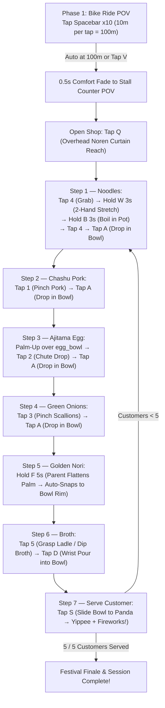

# 🍜 Yatai Together (屋台トゥギャザー) — The Festival Ramen Cart

**Asymmetric Reframed Reality (ARR) for Paediatric Cerebral Palsy Home Rehabilitation & Clinical Assessment**

[](https://unity.com/)
[](#technical-stack)
[](#how-to-install--run)
[](#technical-stack)

---

## 👥 Team — ARR Hackathon
- **Abraham**
- **Luke Zhang**
- **Yuan Deng**
- **Duc Duy Pham**

---

## 📖 What Is *Yatai Together* About?

### The Clinical Challenge
Children with **Unilateral Spastic Cerebral Palsy (Hemiplegia — GMFCS Level I–II, MACS Level II)** experience hypertonic muscle tone that pulls the affected upper limb into a **spastic flexor synergy**:
- Shoulder adduction & internal rotation
- Elbow flexion
- Forearm pronation (locked palm-down)
- Wrist and finger flexion with thumb-in-palm adduction

Because using the affected arm is physically taxing, children often develop **Developmental Disregard** (learned non-use of the affected limb). At home, daily physical therapy and stretching routines frequently become painful, high-friction battles between parent and child—where rushed or uncalibrated stretching triggers **involuntary muscle guarding** and anxiety.

### Our Solution: Asymmetric Reframed Reality (ARR)
**Reframing $\neq$ Distraction.** Conventional VR therapy often relies on passive distraction—disconnecting the child from their body while someone stretches their limb. *Yatai Together* takes the opposite approach: **Passive Haptic Reframing**.

Set at a vibrant Japanese night festival (*Hanabi Matsuri*), *Yatai Together* transforms daily upper- and lower-limb rehabilitation exercises into a cooperative **Festival Ramen Cart (`Yatai`)** run by two partners in a shared physical-virtual space:

1. **🧑‍🍳 The Child (Head Ramen Chef — in Meta Quest 3 VR):**
   Rides the ramen bicycle cart to the festival and prepares 5 bowls of ramen for **Po the Giant Panda** and festival animal customers. Every physical stretch, pinch, forearm supination, and parent-assisted palm press is reframed 1:1 as an authentic culinary action.
2. **🥢 The Parent / Caregiver (Sous-Chef Partner — in the Real World on Laptop):**
   **Never wears a headset.** The parent remains eyes-on with the child to safely support the elbow, guide stretches, place tangible props into the child's hand, and operate a **one-handed left-side keyboard cluster** while viewing the **Sous-Chef Kitchen Deck HUD** on the laptop.
3. **🩺 The Physiotherapist (Clinical Oversight):**
   Benefits from structured, repeatable movement sequences, hold-duration enforcement, and anti-guarding pacing gates.

---

## ✨ Key Innovations & Design Pillars

### 1. Hybrid Hotkey Actuation (*"Quest Tracks WHERE, Parent Decides WHEN"*)
When a parent physically supports a child's spastic hand or places small, soft props (yarn noodles, silicone pork/egg, paper scallions) into their palm, the parent's hands naturally occlude the Quest 3 tracking cameras.
- **Continuous 3D Channel (Quest 3 Optical Hand Tracking):** Continuously tracks the child's wrist and hand pose in 3D space so held virtual ingredients follow the real arm. If optical tracking drops due to occlusion, the virtual hand holds its last valid pose without interrupting gameplay.
- **Discrete Event Channel (Parent's One-Handed Keyboard Cluster):** Every attachment, release, timed stretch hold, egg drop synchronization, and camera transition is deterministically triggered by the parent's free hand on the laptop keyboard—guaranteeing **100% reliability and zero tracking frustration**.

```
               HYBRID PROP-TO-VR SYNCHRONIZATION PIPELINE
 ┌─────────────────────────────┐       ┌─────────────────────────────┐
 │   CHILD (Real World + VR)   │       │  PARENT (Sous-Chef Station) │
 │ Pinches real silicone pork, │──────►│ Observes grasp in real life │
 │ turns palm up for egg, etc. │       │ Taps 1 / 2 / 3 / 4 / 5 ...  │
 └──────────────┬──────────────┘       └──────────────┬──────────────┘
                │ Quest 3: continuous hand tracking   │ Laptop: discrete hotkey event
                ▼                                     ▼
 ┌───────────────────────────────────────────────────────────────────┐
 │                       UNITY 6 (Yatai Together)                    │
 │ • Snaps 3D ingredient onto the child's tracked virtual hand       │
 │ • Or drops the Magic Egg into the upturned virtual palm           │
 │ • Result: haptic + visual congruency with ZERO tracking lag       │
 └───────────────────────────────────────────────────────────────────┘
```

### 2. 1:1 Spatial Congruency & Vestibular Safety
- **1:1 Tabletop Locking:** The physical table in front of the seated child is mapped 1:1 to the virtual Yatai ramen counter ($1.2 \times 0.6\text{ m}$ at height $Y \approx 0.75\text{ m}$), grounding *Place and Plausibility Illusion*.
- **Zero Artificial Camera Motion:** The `XROrigin` never translates, accelerates, or tilts while the child can see. During the Phase 1 bike ride, the child and cart remain stationary while the lantern-lit village street scrolls past smoothly.
- **Dual Fixed Seated POVs:** Only two fixed seated anchors exist—`BikeSeatAnchor` (POV 1) and `FoodStallCounterAnchor` (POV 2)—transitioned via a $\ge 0.5\text{ s}$ comfort fade.

### 3. Anti-Uncanny Valley & Biofeedback
- Instead of rendering an uncanny human avatar when the parent flattens the child's spastic hand on the table mat, the child sees **Po's warm panda paw** gently pressing a glowing **Golden Nori sheet** for 5 seconds, complete with sparkling biofeedback.
- **Zero-Penalty Pause & Hold Semantics:** Releasing a hold key (`W`, `B`, `F`) early **pauses** the timer rather than resetting or failing it. The child can also reach up to close the **Noren Curtain (`Q`)** at any moment for a zero-penalty **"Simmer Hold"** rest break.

---

## 🦾 Cerebral Palsy Movement Mappings (Counteracting Flexor Synergy)

Every step of the ramen recipe targets a specific component of spastic hemiplegic flexor synergy:

| # | Target CP Movement | Real-World Physical Action (Child + Parent) | VR Culinary Reframe | Parent Hotkey |
| :-: | :--- | :--- | :--- | :---: |
| **1** | **Lower-limb active cycling stretch** | Seated cycling leg motion; parent coaches pace | Pedal the ramen bike-cart $10\text{ m}$ per stretch ($100\text{ m}$ total to festival) | `Spacebar` ($\times 10$) |
| **2** | **Overhead reach** (shoulder flexion) | Reach arms high overhead | Roll up the *Noren* stall curtain to open shop (or lower to rest) | `Q` |
| **3** | **Pinch & bimanual abduction** | Pinch yarn noodles, pull both wrists outward apart | Grab 3D noodle bundle and dynamically stretch between both hands for $3\text{ s}$ | `4` $\rightarrow$ Hold `W` ($3\text{ s}$) |
| **4** | **Elbow extension & sustained hold** | Reach forward over Zone A pot while parent supports elbow | Submerge & boil noodles in the boiler pot with a $3\text{ s}$ progress ring, then scoop to bowl | Hold `B` ($3\text{ s}$) $\rightarrow$ `4` $\rightarrow$ `A` |
| **5** | **Finger opening & pinch** | Open curled fingers and pinch squishy silicone pork | Pick up 3D `ChashuPork` slice and drop into ramen bowl | `1` $\rightarrow$ `A` / `Enter` |
| **6** | **Forearm supination** (palm-up) | Turn forearm palm-up over `egg_bowl`; parent drops real silicone egg into palm | Overhead bamboo chute drops a golden *Ajitama* egg into the virtual palm in $0.18\text{ s}$ sync | `2` $\rightarrow$ `A` / `Enter` |
| **7** | **Fine pinch & release** | Pinch shredded paper/foam scallions and release over bowl | Grab 3D `GreenOnions` cluster and scatter into ramen bowl | `3` $\rightarrow$ `A` / `Enter` |
| **8** | **Assisted wrist & finger flexor release** | Child rests hand on pad; parent gently flattens palm & fingers for $5\text{ s}$ | Po's warm paw presses a sizzling **Golden Nori** sheet flat, then snaps it onto the bowl rim | Hold `F` ($5\text{ s}$) |
| **9** | **Gross grasp & wrist rotation** | Grasp lightweight ladle, dip in broth pot, rotate wrist over bowl | Scoop steaming broth with ladle and pour with $2.5\times$ visual-motor rotational gain | `5` $\rightarrow$ `D` |
| **10** | **Two-hand forward reach** | Push the physical bowl forward across the counter | Slide finished ramen bowl to Po, triggering a *"Yippee!"* celebration & *Hanabi* fireworks | `S` |

---

## 🛠️ How to Install & Play

### 1. Prerequisites
- **Unity Hub** with **Unity 6 (`6000.6.8f1`)** installed (including Android Build Support if deploying to Meta Quest).
- **Hardware Options:**
  - **Full ARR Experience:** Meta Quest 3 / Quest 3S (via Quest Link or standalone APK) + a laptop/PC for the Parent Sous-Chef keyboard & Kitchen Deck HUD.
  - **Desktop / Editor Evaluation Mode:** No headset required! The project includes the **Unity XR Device Simulator** and full keyboard actuation so every phase, physics interaction, and cooking step can be played directly in the Unity Editor.

### 2. Installation Steps
1. **Clone the repository:**
   ```bash
   git clone https://github.com/Dealexice/ARR-HACKATHON-FINAL.git
   cd ARR-HACKATHON-FINAL
   ```
2. **Open in Unity Hub:**
   - Click **Add $\rightarrow$ Add project from disk** and select the cloned repository folder.
   - Open the project with **Unity `6000.6.8f1`**. (Unity will automatically resolve packages from `Packages/manifest.json` and generate the `Library/` directory on first launch).
3. **Load the Main Scene:**
   - In the Project window, navigate to:
     ```
     Assets/_ARR_Hackathon/Scenes/YataiTogether_Main.unity
     ```
   - Double-click `YataiTogether_Main.unity` to open it.
4. **Press Play (`▶`) in the Unity Editor!**

---

## 🎮 How to Play (Step-by-Step Gameplay Guide)

### Ergonomic One-Handed Parent Keyboard Cluster
Because the parent uses one hand to physically guide and support the child's affected arm, **all controls sit on the left side of the keyboard** (plus `Spacebar`, `Enter`, and `Backspace`):

```
┌─────────────────────────────────────────────────────────────────────────────┐
│                   PARENT ONE-HANDED KEYBOARD CLUSTER                        │
│                                                                             │
│   [ 1 ]     [ 2 ]     [ 3 ]     [ 4 ]     [ 5 ]              [ Backspace ]  │
│   Pork     Egg Drop   Onions   Noodles    Ladle              Reset Step     │
│  (Pinch)  (Palm-Up)  (Pinch)   (Pinch)   (Grasp)                            │
│                                                                             │
│      [ Q ]     [ W ]     [ E ]     [ B ]                                    │
│     Curtain   2-Hand    Elbow      Boil Timer                               │
│     Reach    Band Pull  Stretch   (Hold 3s)                                 │
│                                                                             │
│         [ A ]     [ S ]     [ D ]     [ F ]                  [   ENTER   ]  │
│         Drop     Serve    Pour Broth  Flatten                Drop / Release │
│        in Bowl  Customer  (Wrist)    Hand (Hold)             Held Item      │
│                                                                             │
│                        [       SPACEBAR       ]              [     V     ]  │
│                         Bike Pedal (+10 Meters)               Switch POV    │
└─────────────────────────────────────────────────────────────────────────────┘
```

### Strict Assembly Sequence Law
To build motor habits and prevent accidental out-of-order key presses, `YataiSessionDirector` enforces a **strict, glitch-proof state machine**. Out-of-order keys are gently rejected with a HUD prompt on the Parent Kitchen Deck.



### Walkthrough by Phase
1. **Phase 1 — Pedal to the Festival (`Spacebar` $\times 10$ or `V`):**
   - You start seated on the ramen bicycle (`BikeSeatAnchor`).
   - Tap **`Spacebar` 10 times** (each tap advances $10\text{ m}$, turns the pedals, chimes the bike bell, and updates the milestone banner up to `100m / 100m`).
   - At $100\text{ m}$, the camera smoothly fades to the Ramen Stall Counter (`FoodStallCounterAnchor`). *(Tip: Press **`V`** at any time to toggle between Bike POV and Stall POV).*
2. **Phase 2 — Open the Stall (`Q`):**
   - Press **`Q`** as the child reaches overhead to roll up the *Noren* stall curtain with a festival drum roll.
   - Pressing **`Q`** again during cooking lowers the curtain for a zero-penalty **Simmer Hold** rest break.
3. **Phase 3 — Cook & Assemble the Ramen Bowl (Repeat for 5 Customers):**
   - **Noodles:** Press **`4`** to grab the raw noodle bundle $\rightarrow$ Hold **`W` for 3 seconds** to stretch the noodles between both hands $\rightarrow$ Hold **`B` for 3 seconds** to boil them in the Zone A boiler pot (flashes green when cooked) $\rightarrow$ Press **`4`** to scoop cooked noodles from the pot $\rightarrow$ Press **`A`** (or `Enter`) to drop them into the ramen bowl (`lamian_bowl`).
   - **Chashu Pork:** Press **`1`** to pinch a slice of pork $\rightarrow$ Press **`A`** to drop it into the bowl.
   - **Ajitama Egg:** Position hand palm-up above the `egg_bowl` $\rightarrow$ Press **`2`** to drop the marinated egg from the chute into the palm $\rightarrow$ Press **`A`** to place it into the ramen bowl.
   - **Green Onions:** Press **`3`** to pinch green scallions $\rightarrow$ Press **`A`** to scatter them into the bowl.
   - **Golden Nori Press:** Hold **`F` for 5 seconds** while flattening the palm on the mat. Po's warm paw presses the Golden Nori with sparkling particles; at $5.0\text{ s}$ it automatically snaps onto the rim of the bowl.
   - **Rich Broth:** Press **`5`** to grasp the ladle and scoop broth $\rightarrow$ Press **`D`** to tilt the wrist ($2.5\times$ rotational gain) and fill the bowl with steaming broth.
4. **Phase 4 — Serve & Celebrate (`S`):**
   - Press **`S`** (or physically push the bowl forward in VR) to slide the completed ramen bowl across the counter to Po the Panda.
   - Enjoy the **"Yippee!"** celebration, confetti burst, and *Hanabi* fireworks! After $1.8\text{ s}$, a fresh empty bowl resets in Zone C for the next customer ($1/5 \rightarrow 5/5$).
5. **Universal Failsafe Key (`Backspace`):**
   - If a physical prop drops early or needs repositioning, press **`Backspace`** for a zero-penalty step reset/alignment without losing recipe progress.

---

## 🗺️ Physical Tabletop Mat Layout (Optional Tangible Props)

For the full tangible Passive Haptic Reframing setup, place a $1.2 \times 0.6\text{ m}$ mat on a table in front of the seated child:

```
                  PHYSICAL TABLETOP LAYOUT MAT (TOP-DOWN, child sits at bottom edge)
┌──────────────────────────────────────┬──────────────────────────────────────┐
│ [ZONE A: Boiler & Broth Station]     │ [ZONE B: Ingredients (2x2 Trays)]    │
│ • Top-Left: Boiler pot (Key B:       │ • Box 1: Cotton-string noodles  (4)  │
│   3s elbow-extension boil target)    │ • Box 2: Silicone Chashu pork   (1)  │
│ • Bot-Left: Broth pot + light ladle  │ • Box 3: Silicone egg halves    (2)  │
│   (Key 5: gross grasp)               │   (dropped by parent above egg_bowl) │
│                                      │ • Box 4: Paper/foam green onions (3) │
├──────────────────────────────────────┼──────────────────────────────────────┤
│ [ZONE D: Hand-Flatten & Band Zone]   │ [ZONE C: Assembly Bowl]              │
│ • Padded flat-hand pad: parent       │ • Real plastic ramen bowl, anchored  │
│   flattens & holds child's palm (F)  │ • Reach & release target (A / Enter) │
│ • Resistance band for 2-hand pull (W)│ • Wrist pour target (D)              │
│                                      │ • Push forward to serve (S)          │
└──────────────────────────────────────┴──────────────────────────────────────┘
                     Under-desk: chair for cycling leg stretches (Spacebar)
                     Overhead: Noren curtain reach (Q)
```

---

## 🏗️ Project Architecture & Repository Structure

```text
ARR-HACKATHON-FINAL/
├── AGENTS.md                        # Architectural laws, clinical safety rules & interaction specs
├── Docs/
│   ├── game_concept_document.md     # Full clinical rationale, choreography & hotkey design
│   ├── MVP_skeleton.md              # Step-by-step atomic build plan & verification gates (Steps 0–13)
│   ├── implementation_roadmap.md    # Component breakdown & technical decisions
│   └── reference/                   # Reference actuator patterns
├── Assets/
│   └── _ARR_Hackathon/              # All custom project assets & scripts
│       ├── Scenes/
│       │   └── YataiTogether_Main.unity   # Main playable festival scene
│       ├── Scripts/
│       │   ├── Input/               # ParentHotkeyRouter, ParentAction, HybridHotkeyActuator
│       │   ├── Director/            # YataiSessionDirector (strict sequence state machine)
│       │   ├── CameraRig/           # PovRigController, DualPOVManager (0.5s comfort fades)
│       │   ├── BikeRide/            # BikeRideController (100m spline/road scroll)
│       │   ├── Stall/               # NorenCurtain (overhead reach & Simmer Hold pause)
│       │   ├── Cooking/             # Station controllers (Noodle, Boiler, Pork, Egg, Onion, Nori, Broth, Serve)
│       │   ├── UI/                  # KitchenDeckHUD & ParentGuidanceHUDOverlay
│       │   ├── Audio/               # AmbientAudioController (soft-attack envelopes)
│       │   └── Editor/              # Automated Editor Play Mode test runners & scene setup utilities
│       ├── Prefabs/                 # Interactive props (noodle, meat, egg, onion, spoon, Panda, Test Street03)
│       ├── Materials/               # Cooked noodle, crispy nori & broth shaders/materials
│       └── Audio/                   # Festival BGM and ambient street soundscapes
├── Packages/
│   └── manifest.json                # Unity package dependencies (OpenXR, XRI, Meta XR SDK, URP)
└── ProjectSettings/                 # Unity 6 project & XR configuration
```

---

## 🔧 Technical Stack
- **Engine:** Unity `6000.6.8f1` (Unity 6)
- **Render Pipeline:** Universal Render Pipeline (`URP 17.6.0`)
- **XR & Interaction:**
  - OpenXR Plugin (`1.19.0`)
  - XR Interaction Toolkit (`XRI 3.7.0`) + XR Hands (`1.6.3`)
  - Meta XR Core SDK & Interaction SDK (`v207`) — every interactive prop (`noodle`, `meat`, `egg`, `onion`, `spoon`) implements the full `Rigidbody` + Convex `Collider` + `Grabbable` + `HandGrabInteractable` stack alongside deterministic parent hotkey fallbacks.
- **Input:** Unity Input System (`1.20.0`, `activeInputHandler: 1`) routed through a single centralized `ParentHotkeyRouter`.
